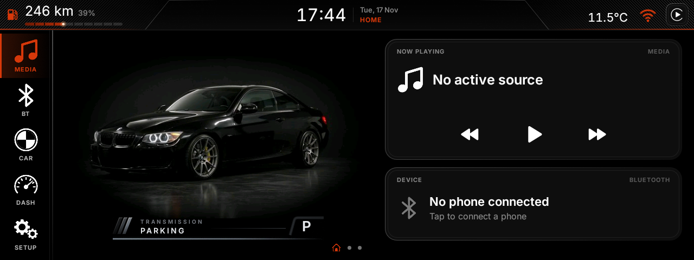
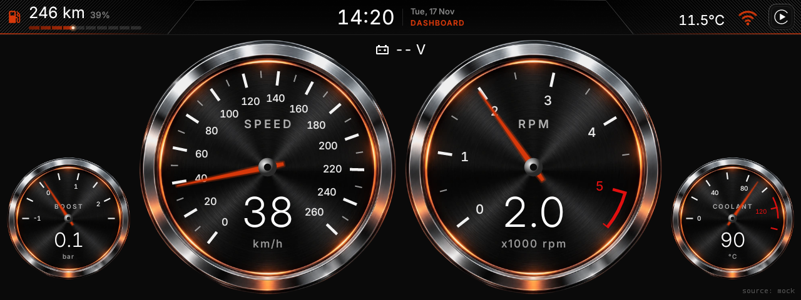

# E92 Launcher

The factory navigation in my BMW E92 (320d, automatic) stopped working. I replaced it with aftermarket Android head units, but their interfaces were slow and hard to use while driving. So I built my own launcher from scratch.

It runs on a KSW head unit with a 10.25" screen (1280x480), Android 8.1 and 2 GB of RAM. It is controlled with the iDrive-style knob and the steering wheel buttons, shows live data from the car, and is designed to look like a modern BMW interface.

## Screenshots

| Home (car in Park) | Dashboard |
|---|---|
|  |  |

| Traction control turned off |
|---|
|  |

## What it does

### Controlled without touching the screen
- Everything works with the rotary knob and the steering wheel buttons.
- Turning the knob quickly jumps 2 or 5 items at a time, so long lists are fast to scroll. Changing direction goes back to one item at a time.
- New buttons can be assigned to actions from the "Learn Key" option in Button mapping.

### Live data from the car
The launcher combines several sources and uses the best one available for each value:

| Source | What it provides |
|---|---|
| CAN bus (through the head unit) | gear lever position (P, R, N, D), Drive Sport on or off, traction control on or off, rear parking sensors, steering angle, battery voltage, the time from the instrument cluster |
| Head unit car data | speed, rpm, fuel, range, outside temperature, handbrake |
| OBD-II Wi-Fi adapter (ELM327) | speed, rpm, boost, coolant temperature, fuel level |
| GPS | speed and time when nothing else is available |

The head unit does not normally give CAN data to apps. A factory setting makes it forward raw CAN messages to its own system log, and the launcher reads them from there. I found which messages mean what by recording data in the car while changing one thing at a time (shifting gear, pressing the traction control button), then checking each one with blind tests.

### Screens
- **Home:** a 360-degree view of the car that rotates with a swipe, a media widget, a Bluetooth widget, and the current gear and driving mode under the car.
- **Dashboard:** speedometer, rev counter, boost, coolant temperature and battery voltage, drawn in code to look like the E92 instrument cluster.
- **Media:** song info and controls from any music app on the unit, plus Bluetooth music from the phone.
- **Phone and Messages:** menus for redial, contacts and dial pad, and a call screen with answer, decline and hang up. Contacts and messages open the unit's own apps.
- **Bluetooth:** connect a new phone, Bluetooth settings, reset.
- **Two-pane screens** (list on the left, details on the right) for settings, Bluetooth, phone and messages.
- **Trip computer:** time, distance and averages for the current drive.
- **Reverse view:** parking sensor distances and steering guide lines when reverse is engaged.
- **Driving mode scenes:** short animations when Drive Sport or traction control is turned on or off.
- **Diagnostics:** a screen with the unit's state, and a small built-in web server that lets me install new versions and read logs over Wi-Fi from a laptop.

### Built for 2 GB of RAM
- One activity with standard Android Views. No Jetpack Compose and no dependency injection framework.
- Gauges and animations are drawn directly on the canvas, without creating new objects while drawing, so there are no pauses from garbage collection.
- Large images are decoded once, cached, and released when their screen is not visible.

### Tested in the car
Every version was installed and tested on the real head unit in the car. I prepared about 70 versions for the car and tagged each one in git, so I could go back to a working version quickly. New screens were first checked on an Android emulator with simulated car data.

## Tech stack
- Kotlin
- Android Studio
- Android 8.1 (API 27)
- Android Views, ConstraintLayout, ViewBinding, Kotlin coroutines and StateFlow

## Build and install

Requirements: JDK 21 and the Android SDK. The app is made for a 1280x480 screen (the head unit or a 1280x480 emulator).

```bash
./gradlew assembleRelease
```

The release APK is at `app/build/outputs/apk/release/app-release.apk`. It is signed with the Android debug key of the computer that builds it, so new versions install over the previous one from the same computer. The debug build has a different package name (`ro.e92.launcher.debug`) and installs as a separate app.

More details:
- [docs/prima-instalare.md](docs/prima-instalare.md): first installation on the head unit
- [docs/testing-on-unit.md](docs/testing-on-unit.md): how to test on the head unit

## Known limitations
- Reading CAN data needs one permission (`READ_LOGS`) granted once over adb.
- The CAN values were worked out on this car and checked in this car only.
- Because of a bug in the head unit's Bluetooth firmware, Bluetooth on this car is set to music only, so calls do not go through the head unit.
- The launcher's own reverse view appears on the first reverse after the car starts. After that, the head unit's built-in camera screen takes over, because it is switched by the unit's hardware and not by Android.
