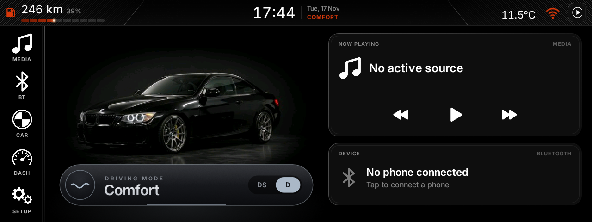
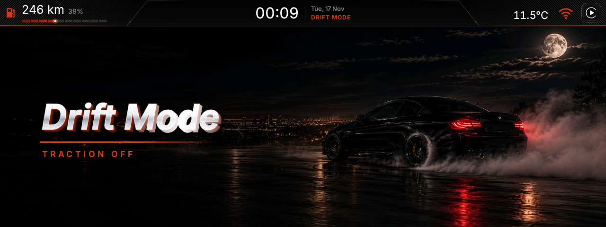
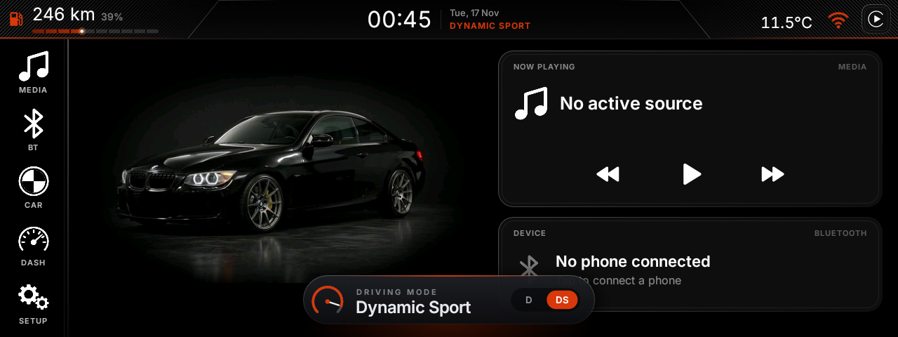
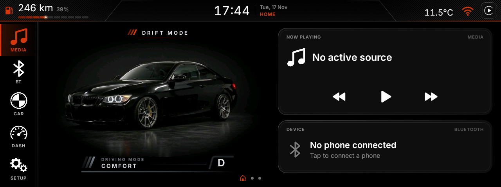

# E92 Launcher

A custom Android launcher and vehicle interface for a 2009 BMW E92 320d (automatic), built to replace the stock interface of an aftermarket KSW / szchoiceway head unit (RK3399, Android 8.1, 1280x480 display).

The goal was an interface that feels like part of the car rather than a generic tablet: driven by the iDrive-style rotary controller, styled after current BMW iDrive, and fed with live data read directly from the car's CAN bus. Getting there meant working against a closed vendor platform with no documentation, no root access in normal operation, no USB connection to the development machine, and a car that is the only real test bench.

| | |
|---|---|
| Platform | Android 8.1 (API 27), RK3399 head unit, 1280x480 at 160 dpi |
| Language | Kotlin, classic Android Views, single activity |
| Codebase | about 19,000 lines of Kotlin in 93 source files |
| History | 187 commits, 70 tagged builds installed or prepared for the car, August to November 2026 |
| Testing | Android emulator with simulated vehicle data, plus in-car sessions over a Wi-Fi diagnostic link |

## Screenshots

| Home in Park | Shifting into Drive |
|---|---|
|  |  |

| Traction control disabled | Dashboard |
|---|---|
|  |  |

| Dynamic Sport selected | Systems-off indicator on Home |
|---|---|
|  |  |

## Features

**Interface and input**
- Single-activity launcher with its own screen stack, focus engine and rotary acceleration, so the entire UI can be driven from the rotary controller without touching the screen.
- Home screen with a rotating 360-degree view of the car (72 frames extracted from a full-rotation video clip), media and Bluetooth widgets, and a quick-access rail.
- Wheel menus modelled on BMW ID6: three entries per menu, a rotary dial that follows the focused row, and a connector line drawn to the selection.
- Hardware key router for steering-wheel and console buttons, with a "learn key" mode for remapping.
- Startup greeting with a timed animation, an ambient sound and a voice line; a goodbye screen when the engine stops.

**Live vehicle data**
- Gauge cluster drawn on `Canvas` (speed, rpm, boost including vacuum, coolant, battery voltage), modelled on the E92 320d instrument cluster.
- Gear lever position, Drive / Dynamic Sport mode and traction-control state read from CAN, shown permanently on Home and announced with short scenes when they change.
- Clock taken from the instrument cluster over CAN, so the time is correct without a network connection.
- Trip computer, fuel range and outside temperature from the vendor's board data.
- Custom reverse scene with parking sensor distances and steering guide lines decoded from CAN.

**Media and connectivity**
- `MediaSessionManager` integration for track info and transport controls from any media app.
- A replacement Bluetooth music engine that talks directly to the unit's Bluetooth stack, used instead of the vendor's Bluetooth app.
- Volume, brightness and greeting volume controls that act on the head unit itself, not only on Android.

**Maintainability**
- A built-in diagnostic HTTP server for remote installs, event logs, screenshots and simulated vehicle input.
- Settings backup and restore, crash recovery, persistent event log.

## Engineering challenges

The interface work was the visible part. Most of the effort went into making a closed, undocumented vendor platform cooperate. The main problems and how they were solved are below, in roughly the order they came up.

### 1. Integrating with an undocumented vendor platform

The head unit's hardware is controlled by a vendor service (`com.szchoiceway.eventcenter`) that talks to a microcontroller (MCU) over a serial link using framed messages (`F2 00 <cmd> <len> <data> <checksum>`). There is no public API.

- The vendor APKs were decompiled to understand the binder interface (`IEventService`), the transaction codes for sending raw MCU frames, the settings provider the vendor apps read at boot, and the meaning of individual MCU commands.
- The launcher sends MCU frames through the vendor binder for things such as screen brightness (`0x6C`), main volume, reverse display configuration (`0x6A`) and enabling raw CAN forwarding.
- Vendor settings are read and written through the same settings provider the vendor apps use, so values survive reboots and the vendor's own boot sequence picks them up.

### 2. Reading the CAN bus and identifying messages

The unit does not expose CAN data to Android. A factory setting makes the MCU forward raw CAN frames, but only into the vendor service's debug log.

- The launcher holds `READ_LOGS` (granted once over adb) and follows the vendor log in real time, parsing the forwarded frames as they are printed.
- Messages were identified by recording captures while performing one action at a time in the car (shifting, pressing the traction control button, toggling Drive Sport), then confirmed with blind tests: the driver changed a state without saying which, and the decoded value had to match. For example, the traction-control state passed 3 of 3 blind tests and Drive Sport 2 of 2.
- A message that first looked right (`0x304` for Drive Sport) produced false triggers in the car because it also changes with the selected gear; it was replaced once a reliable message was found.

| CAN ID | Meaning | Notes |
|---|---|---|
| `0x1C2` | Rear parking sensor distances | 4 sensors, `0xFE` = no obstacle |
| `0x0C4` | Steering angle | signed 16-bit, used for reverse guide lines |
| `0x1D2` | Gear lever position and Drive Sport | byte 0: `E1` P, `D2` R, `B4` N, `78` D; byte 4 bit 0: Sport |
| `0x19E` | DSC / DTC state | byte 1 bit `0x10` set = systems disabled |
| `0x316` | DSC button | one pulse per press |
| `0x2F8` | Instrument cluster date and time | used as the system clock |
| `0x3B4` | Battery voltage | `((b1 & 0x0F) << 8 \| b0) * 0.015 V` |

### 3. Keeping CAN load and battery drain under control

Raw forwarding produced up to about 240 frames per second, roughly half of the MCU link's capacity, and the vendor service logs and processes every frame. Early on, the car's battery ran flat after a long session with forwarding enabled and the ignition on (the cause was never proven, but it shaped the design).

- Forwarding is only requested when needed: in reverse, while waiting once for the cluster clock, and while the engine is running.
- It starts 2 seconds after the engine starts, never during cranking, and stops 10 seconds after the engine stops.
- A settings switch limits forwarding to the Dashboard screen only, as a fallback if the always-on mode ever causes problems.
- A lost enable command is detected (no frames arriving) and re-sent.

### 4. Bluetooth audio dropping every 15 seconds

Music from the phone disconnected about 15 seconds after every connection. This was the longest investigation in the project.

- Logs from the Bluetooth stack (a Feasycom `blueware` daemon driving a CSR chip) were read as root, and the vendor Bluetooth app and the daemon were analysed.
- Several hypotheses were tested in the car and ruled out one by one: phonebook sync, volume, the hotspot, pairing keys, the vendor app itself, and auto-reconnect settings.
- Static analysis of the daemon showed that with its licence check failing at boot, bringing up the hands-free profile schedules a disconnect of all profiles 15 seconds later. The fix was to put the stack in a music-only profile (`AT+PROFILE160`, A2DP and AVRCP without hands-free), verified by writing it, reading it back and restarting the stack. Music then streamed without drops in the car.
- The vendor Bluetooth app was replaced with the launcher's own music engine speaking the stack's AT protocol directly (documented in [docs/feasycom-protocol.md](docs/feasycom-protocol.md)). Because the music-only profile no longer reports the phone's name, a known phone is recognised by a salted hash of its address rather than by storing the address.

### 5. The reverse camera screen

The unit shows its own camera screen in reverse (here only "No Signal", the camera is broken), drawn on top of everything. The aim was to replace it with the launcher's own reverse scene.

- Investigation showed the vendor screen is not an Android window (SurfaceFlinger and window dumps showed only the launcher while it was visible) and not the kernel's fast-reverse driver. It is video switching done by the MCU itself.
- The launcher's scene takes over reliably on the first reverse after each start. On later reverses the MCU switches its video path regardless of every documented setting that was tried (camera type, overlays, view mode, heartbeat messages). The findings are written up in [docs/reverse-ksw-brief.md](docs/reverse-ksw-brief.md).
- A related bug, a "No Signal" screen at every start-up, was traced to the MCU requesting the vendor's original-car video mode about 22 seconds after boot; disabling that mode in the vendor settings removed it.

### 6. Animations on a unit with animations disabled

The unit ships with the Android animator duration scale at 0, so standard `Animator`s jump straight to their end state. All transitions, scenes and gauges are drawn frame by frame on their own clock in custom `View`s (`postInvalidateOnAnimation`), with no allocations in `onDraw`.

### 7. Audio that has to be heard through the car's radio

The unit outputs audio to the car's amplifier, and the vendor firmware unmutes Android audio late for each new output. Short sounds were being lost.

- For short audio bursts the output is kept open with a silent `AudioTrack` before and after the sound.
- The startup greeting sets the unit's main volume to a configured level only while it plays, without saving it, and restores the previous level afterwards, so its loudness does not depend on how the unit volume was left.

### 8. Development without a cable

The unit has no USB connection to a computer and its IP address changes. Every test happens in the car.

- The launcher runs a small authenticated HTTP server for installing new builds, reading the event log, taking screenshots, sending test MCU frames and simulating vehicle input.
- PowerShell scripts drive the whole in-car session: find the unit on the hotspot, install, verify the Bluetooth stack, capture logs for a fixed time, and print a pass or fail verdict.
- Every build intended for the car is tagged and archived, so a known-good version can be restored in minutes.
- On the emulator, simulation endpoints replay gear changes, mode changes, music and calls, so new screens can be reviewed before they reach the car.

### 9. Handling personal data

During development a real device address ended up in a test file. Before publishing, the repository history was rewritten to remove it, and the commits that still contain it were never pushed. Device identifiers are compared by hash only.

## Development timeline

- **August to September 2026:** first version: main menu modelled on BMW ID5/ID6, tile grid, rendered icons, CI build on GitHub Actions.
- **Early November:** per-menu backgrounds, crash recovery, settings backup, Inter typeface, chrome gauge cluster modelled on the E92 cluster, remote diagnostic server, first connection to the vendor services.
- **3 to 4 November:** first in-car sessions. Car data from the vendor board protocol, call screen, update mechanism, and the start of the Bluetooth investigation, ending with the launcher's own Bluetooth music engine.
- **7 to 9 November:** raw CAN access, reverse scene with sensors and steering, theming, new Home screen with the rotating car, Bluetooth fixes from the car.
- **15 to 16 November:** cluster clock and battery voltage over CAN, CAN load rules, a dedicated test bench for the reverse screen problem, the start-up "No Signal" fix, identification of the traction-control and Drive Sport messages.
- **17 November:** driving-mode scenes and cards, permanent gear and mode display on Home including Park, systems-off indicator, brightness control, reorganised settings, start-up greeting with sound.

## Architecture

```
ro.e92.launcher
├── can/      vehicle data sources (vendor board data, raw CAN via the vendor log, OBD-II over Wi-Fi, GPS, mock)
│             merged by VehicleRepository into a single VehicleState stream
├── core/     vendor integration (settings provider, volume, Bluetooth stack link), preferences, clock, trip computer
├── focus/    focus graph for rotary and directional input
├── input/    hardware key routing, key learning, rotary acceleration
├── media/    MediaSession hub, Bluetooth music, parking beeps, greeting audio
├── remote/   diagnostic HTTP server
└── ui/       single activity, screen stack, screens and custom-drawn widgets
```

- Hardware access is kept out of the UI. Screens observe `StateFlow`s of vehicle state and react to `LauncherAction`s, so every screen can be exercised on the emulator with simulated data.
- Several data sources can report the same value; the repository picks one per field and throttles updates so the UI is not flooded.
- Services are created once in the `Application` and reached through a small service locator, which keeps start-up fast on limited hardware.

## Known limitations

- The launcher's reverse scene is shown on the first reverse after each start only; later reverses show the unit's own camera screen, which is controlled by the MCU.
- Raw CAN access depends on a factory setting and on reading the vendor log, which requires `READ_LOGS` to be granted once over adb.
- Values decoded from CAN are specific to this car and were verified in the car, not against official documentation.

## Build and install

Requirements: JDK 21 and the Android SDK. Builds target a 1280x480 emulator or the head unit.

```bash
./gradlew assembleRelease
```

The release APK is signed with the included debug keystore so it installs over the existing app on the unit. The debug build uses a different package name and installs alongside it.

Further documentation:
- [docs/testing-on-unit.md](docs/testing-on-unit.md): field guide for testing on the head unit
- [docs/prima-instalare.md](docs/prima-instalare.md): first installation on the unit
- [docs/feasycom-protocol.md](docs/feasycom-protocol.md): the Bluetooth stack's AT protocol
- [docs/reverse-ksw-brief.md](docs/reverse-ksw-brief.md): reverse camera investigation
